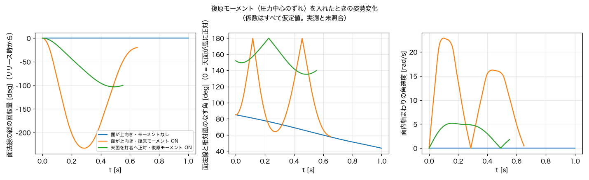
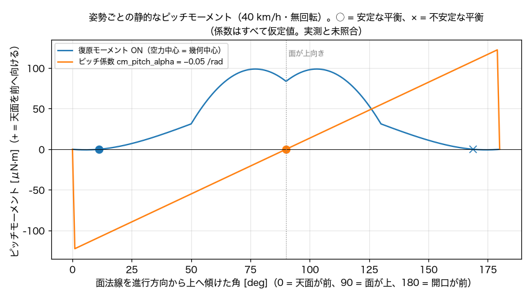
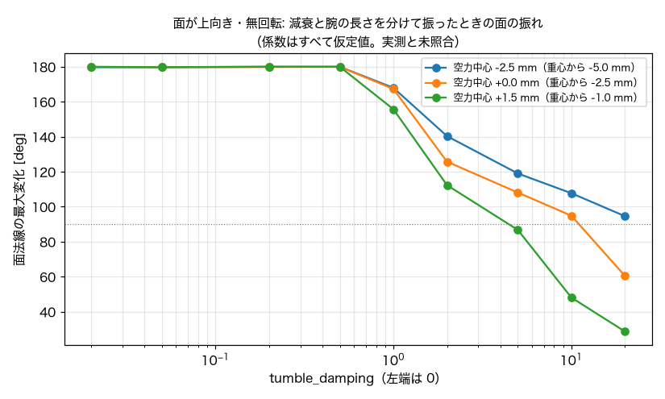
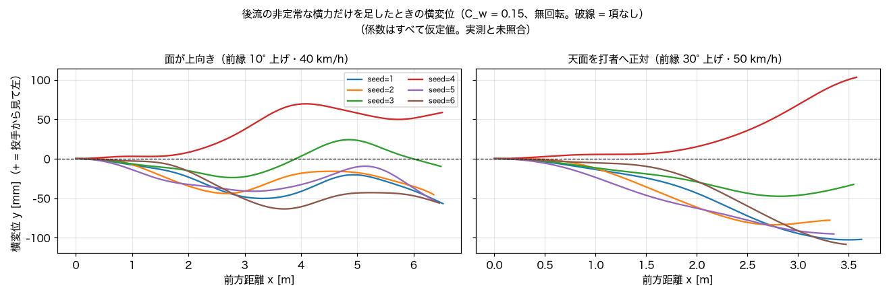
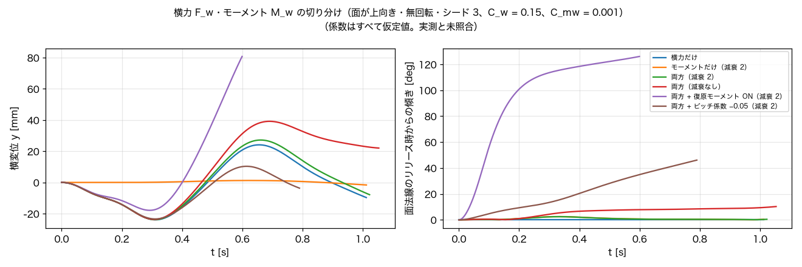

# 低速・低回転キャップの横揺れ: 診断と後流の非定常項（Issue #7）

状態: 実験的なモデルとして追加済み（既定 OFF）。係数はすべて仮定値（`assumed`）で、実測とは照合していない。

結論を先に書く。

- 復原モーメント（圧力中心のずれ）を入れると面が1回転するのは、このモーメントの安定な平衡が「面が上向き」ではなく「閉じた天面が進行方向を向く姿勢」の近くにあるためである。面を上向きにして投げると、平衡から約84°離れた位置から振り出すことになる。減衰を強めても、面は上向きを保たない。
- 姿勢の乱れだけでは、面を上向きに保ったまま左右に切り返す揺れは出なかった。出るのは一方向への流れで、切り返しが出た条件は面が大きく回っていた。
- 相対風に垂直な時間変動の横力 `F_w` を足すと、面を上向きに保ったまま左右に切り返す軌道になる（20シードすべてで2回以上の切り返し、揺れ幅は平均45 mm）。この回数は、切り返しが出るように周波数帯を選んだ結果で、モデルの予測ではない。この項は `aerodynamics.wake` で有効にする。指定しなければ既存の結果は1ビットも変わらない。
- `F_w` の係数と周波数帯は、観察に見た目が合うように置いた値で、流れを解いた結果でも文献値でもない。実際の横揺れの原因が後流の非定常性だと確かめたわけではない。

## 再現方法

```bash
uv run python scripts/issue7_wake_study.py                                # 全スイープ（228条件、並列で約1分）
uv run python -m cap_flight_sim sweep --config experiments/G_wake_unsteady.yaml --output output/G_wake_unsteady   # 代表7条件
```

`scripts/issue7_wake_study.py` は `output/issue7_wake_study/` に、条件ごとの値（`runs.csv`）、時系列（`series.json`）、静的なモーメントと通常球への影響（`checks.json`）、図5枚を書き出す。このレポートの数値は、同じ内容を `docs/issue7/` にコピーした `runs.csv` と `checks.json` から取った。計測関数と診断の要点は `tests/test_issue7_study.py`、モデルの性質は `tests/test_wake.py` で検証している。

条件の基準は次のとおり。

| 項目 | 基準値 |
|---|---|
| 面が上向き（`face_up`） | 円形面を上向き、前縁を10°上げる、無回転、40 km/h、リリース高 1.45 m、仰角5°。Issue #7 の観察に対応する |
| 天面を打者へ正対（`face_forward`） | 閉じた天面を打者へ正対、前縁を30°上げる、無回転、50 km/h、仰角2°。Issue #1 で使ったナックルのリリース姿勢 |
| 復原モーメント ON | 圧力中心を body 原点に置く（重心は薄肉カップ近似で天面側 2.5 mm）。ビューアの「重心のずれによる復原モーメント」ON の既定と同じ |
| 積分 | 固定刻み RK4（1e-4 s） |

Issue #7 の本文は「円形面が概ね上向き」、Issue #1 は「天面を打者へ正対」と書いており、姿勢が違う。どちらが実際の投球に近いかは未確認なので、両方を計算して区別して示す。

## Phase 1: 現行モデルの診断

### 1. 復原モーメントで面が1回転する条件と理由

面が上向き・無回転・復原モーメント ON で、面法線は縦に233°回り、着地までに裏返る（`face_up/cp_on`。面内軸まわりの角速度は最大 22.9 rad/s）。モーメントなしでは姿勢は変わらない。



理由は、姿勢ごとの静的なピッチモーメントを見ると分かる。次の図は、面法線を進行方向から上へ傾けた角に対するモーメントである（40 km/h・無回転）。



| 面法線を進行方向から上へ傾けた角 | 1° | 10° | 20° | 45° | 80° | 90° | 135° | 170° |
|---|---|---|---|---|---|---|---|---|
| 復原モーメント ON のモーメント [μN·m] | −0.25 | −0.30 | +3.7 | +26 | +98 | +84 | +26 | −0.30 |

基準の `face_up` は前縁を10°上げて仰角5°で投げるので、リリース時の角は 95°（モーメントは +93 μN·m）になる。

正の値は天面を前へ向ける向き。

- 安定な平衡は 11.3° にある（天面がほぼ進行方向を向く姿勢）。不安定な平衡は 168.7°。面が上向き（90°）の近くに平衡は無い。
- 圧力中心が重心より開口側にあるので、空気力は重い天面側を前へ向けようとする。バドミントンのシャトルと同じ向きの安定で、ビューアの説明文にも「シャトル型」と出る。
- リリース時（95°）は平衡から約84°離れていて、モーメントは最大に近い（93 μN·m）。面内軸まわりの慣性モーメントは 2.6e-7 kg·m² なので、角加速度は約 360 rad/s² になる。0.1秒ほどで天面が前を向き、減衰が無いのでそのまま行き過ぎて裏返る。
- `face_forward` では、リリース時に平衡から約17°しか離れていない（面法線の仰角30°、進行方向の仰角2°、平衡 11.3°）。それでも面法線は103°振れる。面法線は平衡をまたいで反対側へ振れ（進行方向からの角は最大45°）、その間に進行方向が仰角2°から −30° まで下を向くためである。

つまり、この項は「面を上向きに戻す」復原モーメントではない。面を上向きにして投げる条件で ON にすると、面が上向きを保たないのはモデルの式どおりの挙動である。

### 2. 減衰と腕の長さを分けて振っても、面は上向きを保たない



面法線の最大変化（面が上向き・無回転）:

| `tumble_damping` | 0 | 0.2 | 1 | 2 | 5 | 10 | 20 |
|---|---|---|---|---|---|---|---|
| 圧力中心が重心から −1.0 mm | 180° | 180° | 156° | 112° | 87° | 48° | 29° |
| 同 −2.5 mm（復原モーメント ON の既定） | 180° | 180° | 167° | 126° | 108° | 95° | 60° |
| 同 −5.0 mm | 180° | 180° | 168° | 140° | 119° | 108° | 95° |

- 減衰を1以上にすると裏返らなくなるが、面は平衡（天面が前）へ向かって倒れる。`tumble_damping` 20 でも 60° 傾く。Issue #1 の感度分析で振った範囲（0.2以下）では効果が見えなかったのは、必要な減衰がその10倍以上だったためである。
- 腕を短くすると倒れる速さは下がるが、向かう先は変わらない。
- 面が上向きの姿勢を保つには、減衰の強さではなく、平衡の位置を変える項が必要になる。

### 3. ピッチモーメント係数の符号と平衡

`cm_pitch_alpha_per_rad` は、負の値で迎角 α = 0（面が相対風と平行）が安定な平衡になる（図2の橙の線）。面が上向きの姿勢はこの平衡の近くにある。

| `cm_pitch_alpha_per_rad` | −0.2 | −0.05 | −0.01 | +0.01 | +0.05 |
|---|---|---|---|---|---|
| 面法線の最大変化（減衰 0） | 51° | 53° | 59° | 180°（裏返る） | 180°（裏返る） |
| 同（減衰 2） | 49° | 45° | 26° | 51° | 94° |

- 正の値は不安定で、面が裏返る。
- 負の値では裏返らないが、面は相対風と平行になろうとして、軌道が下を向くのに合わせて前へ倒れる（45〜59°）。−0.05 の条件では、進行方向が仰角5°から −41° まで下を向く間、迎角は −4〜+6° に収まっていた。地面に対して上向きを保つわけではない。
- この項は、面が相対風に正対する姿勢で符号が飛ぶ（図2の両端。Issue #1 の感度分析の結果4）。面が上向きの姿勢から使うぶんには、その点を通らない。
- `cm_pitch0` は平衡の迎角を `−cm_pitch0 / cm_pitch_alpha_per_rad` だけずらす。今回は振っていない。

### 4. 姿勢の乱れだけでは、切り返す揺れは出ない

面が上向きの条件に、左右の乱れ（右傾き5°、向き5°、ロール角速度 1 rad/s、ヨー角速度 1 rad/s、30 rpm の自転＋右傾き5°）を与えた。揺れは次の2つで測った。

- 切り返しの回数: 横速度の向きが入れ替わった回数（1 mm/s 未満は数えない）
- 揺れ幅: 横変位から直線の流れを引いた残りの最大幅

| モーメントの設定 | 切り返し | 揺れ幅 | 面法線の最大変化 |
|---|---|---|---|
| なし | 0回 | 8〜177 mm | 0〜52° |
| 復原モーメント ON | 0〜4回 | 1〜36 mm | 174〜180°（裏返る） |
| 復原モーメント ON、減衰 2 | 0〜2回 | 2〜144 mm | 126〜134° |
| ピッチ係数 −0.05 | 0〜2回 | 0.3〜35 mm | 53〜83° |
| ピッチ係数 −0.05、減衰 2 | 0〜1回 | 1〜10 mm | 45〜47° |

- モーメントなしでは、傾いた揚力で一方向へ流れるだけで、切り返さない（揺れ幅の値は、流れが時間の2乗で増えるぶんである）。
- 切り返しが2回以上出た条件は、面が 64° 以上回っていた。面が概ね上向きのまま切り返した条件は無い。
- 30 rpm の自転とピッチ係数 −0.05 の組み合わせでは、歳差で面が首を振り、切り返し1回・揺れ幅 35 mm が出た。ただし面法線は 83° 振れる。

この結果から、現行モデルの範囲では「面は概ね上向きのまま、軌道だけが左右に揺れる」を姿勢の変化で説明できない。Issue #1 の感度分析（左右の乱れへの応答は線形で、増幅しない）とも合う。

## Phase 2: 後流の非定常項（実験的・既定 OFF）

### モデル

相対風に垂直な時間変動の力とモーメントを、位相がランダムな3本の正弦波の和で与える。流れは解いていない。

```
横力        F_w = q · A_proj(α) · C_w · g(S) · [s1(Φ) e1 + s2(Φ) e2]
モーメント  M_w = q · A_proj(α) · D · C_mw · g(S) · [s3(Φ) e1 + s4(Φ) e2]
位相        dΦ/dt = 2π |u| / D
信号        s_j(Φ) = Σ w_i sin(k_i Φ + φ_ji) / sqrt(Σ w_i² / 2)     （RMS = 1）
回転        g(S) = 1 / (1 + (S / S0)²),  S = R |ω| / |u|
```

| 設計 | 内容 | 理由 |
|---|---|---|
| 力の向き | 相対風に垂直な world 固定の基底 `e1`・`e2`（水平飛行では左・上）。真上・真下へ飛ぶときは `e1` を world +Y に固定 | 面法線は、面が風に正対すると向きが決まらず、自転とともに回る。マグヌス力の向き（`ω⊥ × u`）は無回転で 0 になる |
| 周波数 | 無次元 `k = f D / |u|`。位相 `Φ` を状態に足して積分する | 速度は飛行中に半分近くまで落ちる。時刻で `sin(2π f t)` と書くと周波数を速度に合わせられない |
| 乱数 | 位相のずれ `φ` をシードから一度だけ引く（mulberry32）。力の評価中には引かない | RK4 も適応刻みも1ステップに何度も評価する。同じシードなら Python と TS で同じ軌道になる |
| 振幅 | 動圧 `q` と投影面積 `A_proj(α)` に比例。回転には `g(S)` で連続に依存 | 回転数のしきい値や球種の分岐を持たない（Issue #1 の方針）。`spin_parameter_scale: null` で回転への依存を外せる |
| 横力の作用点 | 重心。圧力中心のずれのモーメントには入れない | 姿勢を直接回さずに、横力だけの感度を見るため。姿勢を回す作用は `M_w` として別に持つ |
| 状態 | 有効なときだけ、13要素の状態の末尾に `Φ` を足す | 無効時の状態と適応刻みの誤差評価を変えないため |

設定は `aerodynamics.wake` に書く。値はすべて仮定値である。

| パラメータ | 既定値 | 意味と根拠 |
|---|---|---|
| `force_coefficient`（`C_w`） | 0（OFF） | 横力の RMS 係数（投影面積基準）。比較では 0.15 を使った |
| `moment_coefficient`（`C_mw`） | 0（OFF） | モーメントの RMS 係数（投影面積 × 外径基準）。比較では 0.001 を使った |
| `seed` | 1 | 0 以上 2³² 未満の整数。揺れ方が変わる |
| `reduced_frequencies`（`k`） | 0.006 / 0.011 / 0.02 | 揺れ1回の飛行距離が `D / k` = 5.0 / 2.7 / 1.5 m になる（40 km/h なら 2.2 / 4.1 / 7.4 Hz）。9.22 m の投球で数回揺れて見える帯域に置いた。最初に試した 0.004 / 0.009 / 0.02 では、面が上向きの条件で2回以上切り返すシードが 20% しかなく、一方向の流れに見えたので高い側へ寄せた |
| `weights` | 1.0 / 0.8 / 0.5 | 各正弦波の重み |
| `spin_parameter_scale`（`S0`） | 0.05 | `S = S0` で振幅が半分になる。40 km/h で約 350 rpm に当たる |

周波数帯は渦放出の周波数ではない。渦放出を `St = 0.15` と仮定すると 40 km/h で約 56 Hz になり、2.2 g のキャップを動かす幅は 0.1 mm に届かない。目に見える揺れになるのは数 Hz の成分だけなので、その帯域に置いた。キャップの後流にこの帯域の横力があるかどうかは確かめていない。fk-lab の球用の値（ストローハル数・周波数帯・振幅）は使っていない。

係数表モデル（`aerodynamics.model: lookup_table`）では使えない。有効にするとエラーになる。

### 5. 横力だけを足すと、面は上向きのまま左右に切り返す

`C_w = 0.15`、無回転、シード1〜20。



| 姿勢 | 飛行時間 | 切り返し | 揺れ幅 | 横変位の最大 | 面法線の変化 |
|---|---|---|---|---|---|
| 面が上向き | 1.00 s（6.4 m） | 2〜4回（平均 2.25、全シードで2回以上） | 38〜57 mm（平均 45） | 24〜166 mm（平均 78） | 0° |
| 天面を打者へ正対 | 0.41 s（3.5 m） | 0〜2回（平均 0.7、2回以上は 15%） | 17〜44 mm（平均 31） | 21〜216 mm（平均 115） | 0° |

- 面が上向きの条件では、面を保ったまま左右に切り返す。横力は重心に作用させているので、姿勢は変わらない。
- 天面を打者へ正対させた条件は、現行の仮定（Cd ≈ 1）だと 3.5 m で着地する。飛行が短く、揺れ1回ぶんに届かないので、一方向への流れに見える。
- 横変位の最大が揺れ幅より大きいのは、リリース時の位相で決まる一方向の流れが乗るためである。向きはシードで変わる。

係数と速度への依存（面が上向き・シード3）:

| 条件 | `C_w` 0.05 | 0.10 | 0.15 | 0.30 | 30 km/h | 40 km/h | 50 km/h |
|---|---|---|---|---|---|---|---|
| 揺れ幅 [mm] | 14 | 28 | 42 | 87 | 44 | 42 | 44 |

揺れ幅は `C_w` に比例する。速度にはほとんど依存しない。力は速度の2乗、周波数は速度に比例するので、打ち消し合うためである。揺れの波長（飛行距離あたりの回数）も速度で変わらない。

### 6. 横力とモーメントの切り分け

面が上向き・無回転・シード1〜10 の平均。`C_w = 0.15`、`C_mw = 0.001`。



| 構成 | 揺れ幅 | 切り返し | 面法線の最大変化 |
|---|---|---|---|
| 横力だけ | 44 mm | 2.3回 | 0° |
| モーメントだけ（減衰 2） | 2.5 mm | 0.9回 | 2.4°（最大 2.9°） |
| 両方（減衰 2） | 45 mm | 2.3回 | 2.5°（最大 2.9°） |
| 両方（減衰なし） | 44 mm | 2.3回 | 16°（最大 22°） |
| 両方 + 復原モーメント ON（減衰 2） | 42 mm | 0.9回 | 127° |
| 両方 + ピッチ係数 −0.05（減衰 2） | 35 mm | 2.1回 | 45° |

- 横揺れを作っているのは横力で、モーメントだけでは揺れ幅が 2.5 mm にとどまる。面が数度揺れても、揚力の傾きによる横変位は小さい。
- モーメントを足すと、面が数度ゆれる見た目になる。減衰が無いと振れが溜まっていく（16°）ので、`M_w` を使うときは `tumble_damping` を併用する。
- 復原モーメント ON と組み合わせると、結果1の理由で面が倒れる。

## Phase 3: 回帰の確認

### 既存の結果を変えていない

- `aerodynamics.wake` を書かない設定は、既定の積分器（DOP853）でも固定刻み RK4 でも、変更前と同じ結果になる。通常球の回帰基準（`tests/regression/normal_pitches_baseline.json`）、プリセット、UI の書き出しの照合用データは変更していない。
- 係数を両方 0 にした設定も、書かない設定と軌道が一致する（`tests/test_wake.py`）。
- TS との照合用ゴールデンは、既存のケースを変えずに4ケースを足した（状態微分2変種、軌道2ケース）。TS 側は Python と、状態微分が相対 1e-10、軌道の位置が 1e-8 m の許容で一致する。
- 有効にした軌道（横力とモーメントの両方、減衰なし）は、刻みを 2e-4 s から半分にしたときの着地点の差が 4e-9 m、DOP853 との差が 1e-8 m だった。テストの許容は 1e-7 m と 1e-4 m。

### 回転数への依存

面が上向き・シード3で、着地点の横変位が横力の有無でどれだけ変わるかを見た。

| 回転数 | 0 | 30 | 100 | 300 | 1000 | 1500 rpm |
|---|---|---|---|---|---|---|
| 横変位の差（あり − なし） [mm] | −9.7 | −8.7 | −5.0 | −3.6 | −0.2 | +0.3 |
| リリース時の `g(S)` | 1.00 | 0.99 | 0.93 | 0.58 | 0.11 | 0.05 |

回転が速いほど連続的に弱まる。しきい値は無い。300 rpm でも4割ほどしか弱まらないので、`S0` の値はそのまま通常球への影響の大きさを決める。

### 通常球のプリセットに足した場合

`C_w = 0.15` を足し、着地点の差をシード1〜10で見た（4つとも捕手面に届かず着地する）。

| プリセット | 横の差（RMS / 最大） | 前後の差（最大） | 面法線の変化の差 |
|---|---|---|---|
| `overhand_drop`（1200 rpm） | 4.6 / 9.9 mm | 26 mm | 0° |
| `flick_flat`（1500 rpm） | 5.8 / 8.9 mm | 12 mm | 0° |
| `sidearm_flat` | 11 / 24 mm | 17 mm | 0° |
| `spec_example_tumble` | 20 / 40 mm | 27 mm | 0° |

有効にすると通常球も 1〜4 cm 動く。既定を ON にするかどうかは、実測で `C_w` と `S0` の根拠が得られてから判断する。

## 選ばなかった案

- 球種別の「ナックルモード」や、低回転のときだけ横力を足す分岐: Issue #1 で採らないと決めている。回転への依存は `g(S)` の連続関数にした。
- 時刻で決まる周波数（`sin(2π f t)`）: 状態を増やさずに済むが、速度が落ちても揺れの速さが変わらない。位相を積分する方式にした。
- 力の評価ごとに乱数を引く方式: 積分器の評価回数で結果が変わり、再現できない。
- fk-lab の係数・周波数帯の流用: 球用の仮定値で、キャップの寸法と飛行時間に合わない。
- 復原モーメントの式を直して面が上向きの姿勢を安定にする: 根拠になる実測が無い。既定の経路は変えず、挙動の理由を記録するにとどめた。
- Re 依存の振幅: 通過する Reynolds 数は 1〜4e4 の範囲で、依存を入れる根拠が無い。

## 仮定と、実測で確かめていないこと

- 実際の横揺れの原因が後流の非定常な横力かどうか。姿勢の変化、縫い目に当たるような形の非対称、リリース時の微小な回転の影響は切り分けていない。重心の軌道だけの計測では、この区別はつきにくい。
- 観察された揺れの振幅と周期。`C_w` と周波数帯を合わせる対象が無い。動画から横変位の時系列が取れれば、切り返しの回数と揺れ幅を同じ計測関数で比べられる。
- 上下方向にも同じ大きさの変動を与えていること（等方）。左右だけ揺れるのかどうかは未確認。
- 投影面積への比例、回転による減り方（`S0 = 0.05`）、Re に依存しないこと。
- 「円形面が概ね上向き」の投球の初速・仰角・前縁の角度。基準は仮の値である。
- 現行の仮定（Cd ≈ 1）では、どちらの姿勢も捕手面（9.22 m）に届かない。捕手面での比較はできていない。
- 係数表モデルと、モーメントの3軸目（相対風まわり）には対応していない。
