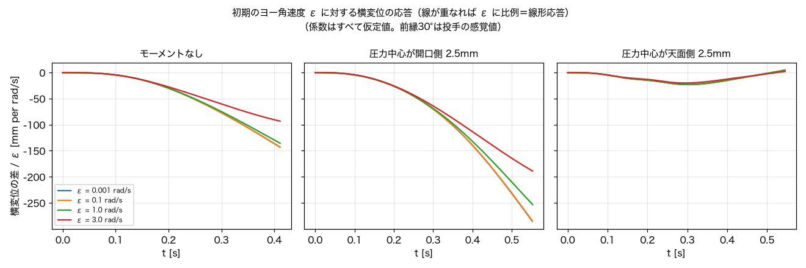
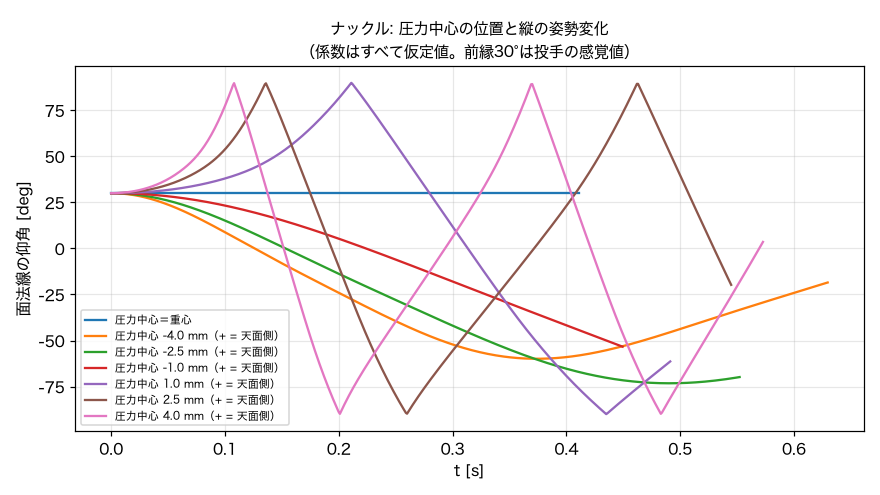
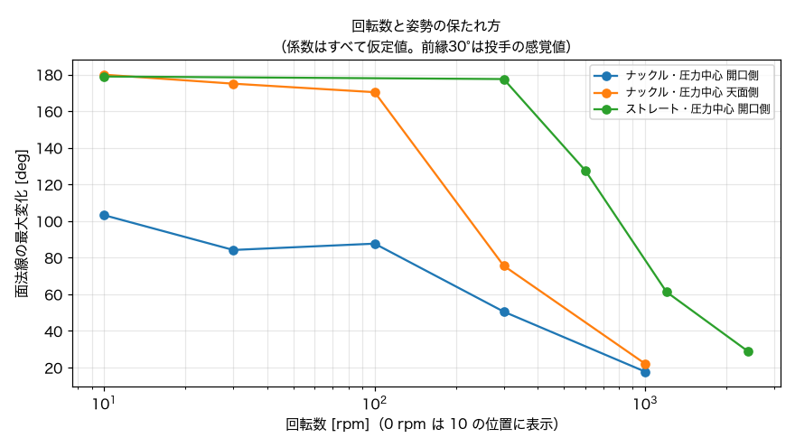
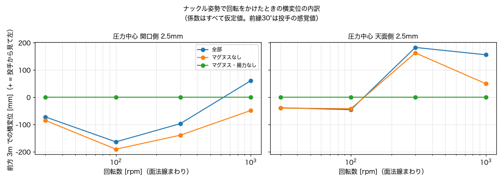

# Phase 2: 現行モデルの感度分析（Issue #1）

現行の剛体・空力モデルを変えずに、ナックルとストレートの条件を1つずつ振り、姿勢と軌道がどう変わるかを調べた。結論を先に書く。

- 現行モデルでは、ナックルは**左右に不規則には動かない**。左右対称な条件では横変位が厳密に 0 になり、左右の初期の乱れを与えても、横変位は乱れの大きさに比例するだけだった。
- 縦の姿勢変化は、圧力中心が重心より天面側か開口側かで大きく分かれる。その向きを決めているのは、正対からの角度に応じた抗力（側面の投影面積を含む）と失速後の揚力の釣り合いで、どちらも仮定の係数による。釣り合いは正対から約 11.5° の角度で逆転する。
- ピッチモーメント係数 `cm_pitch_alpha_per_rad` は、面が相対風に正対する姿勢をまたぐと符号が飛ぶ。ナックルの姿勢では、この項の結果はモデルの不備によるものとして扱う必要がある。
- 回転による姿勢の保持は再現できた。ただし回転数に対して単調ではなく、ナックルの 0〜100 rpm では姿勢の振れがほぼ横ばいだった。

係数はすべて仮定値（`assumed`）で、実測ではない。前縁の傾き 30° は投手の感覚値。

## 再現方法

```bash
uv run python scripts/phase2_sensitivity.py
```

`output/phase2_sensitivity/` に、条件ごとの値（`runs.csv`）、時系列（`series.json`）、正対付近のモーメントの確認（`checks.json`）、図4枚を書き出す（131条件、並列で約20秒）。このレポートの数値は、同じ内容を `docs/phase2/` にコピーした `runs.csv` と `checks.json` から取った。計測関数と、正対付近の剛性の符号・大きさは `tests/test_phase2_metrics.py` で検証している。

条件の基準は次のとおり。

| 項目 | 基準値 |
|---|---|
| ナックル | 天面を打者（+X）へ正対、前縁を 30° 上げる、無回転、50 km/h、リリース高 1.45 m、仰角 2° |
| ストレート | `examples/overhand_drop.yaml`（キャップを立てたトップスピン、58 km/h） |
| 圧力中心 | 「開口側 2.5mm」は body 原点（重心は薄肉カップ近似で天面側 2.5mm にある）。「天面側」はその逆 |
| 積分 | 固定刻み RK4（1e-4 s）。代表3条件を半分の刻みで再計算し、表の値が有効数字の範囲で一致することを確かめた |

着地時刻が条件によって 0.41〜0.89 s と大きく変わるので、比較は着地点ではなく、同じ時刻（0.1・0.2・0.3 s）と同じ前方距離（2・3 m）で行った。

## 結果

### 1. 左右対称な条件では横に動かない

無回転のナックルは、圧力中心・ピッチ係数・減衰・速度・前縁の角度をどう振っても、横変位が厳密に 0 だった。モデルに左右の対称を崩す項がないためである。面の向きを ±ε ずらした対の結果も、厳密に左右反転した（数値誤差 0）。ヨー角速度の乱れは +ε だけで計算した。

### 2. 左右の乱れへの応答は線形で、増幅しない

リリース時に、面の向きを左右に ε 度ずらす条件と、ヨー角速度 ε rad/s を与える条件を、ε = 0.001〜3 の4桁で計算した。



横変位の差を ε で割った値は、ε = 0.001〜0.1 でほぼ完全に重なった（差は 0.1% 未満）。つまり応答は乱れに比例し、飛行中に乱れが指数的に膨らむことはない。ε が 1 を超えると比例からやや外れるが、膨らむ方向ではなく小さくなる方向だった。

大きさの目安（圧力中心が開口側 2.5mm のとき）:

| 初期の乱れ | 0.3 s 後の横変位 |
|---|---|
| 面の向きを左右に 1° | 約 11 mm |
| ヨー角速度 1 rad/s | 約 69 mm（0.4 s 後は約 132 mm） |

モーメントがない条件（ヨー角速度 1 rad/s で 0.3 s 後に約 75 mm）でも同じ桁の横変位が出たので、横変位の主な原因は、面が傾いたことで揚力の向きが横に向くことだと考えられる。圧力中心が天面側だと、キャップが縦に回り続けるため、横変位は約 23 mm にとどまった。

### 3. 縦の姿勢は圧力中心の位置で分かれる



| 圧力中心（重心から） | 縦の回転量（最大） | 挙動 |
|---|---|---|
| 開口側 4.0 / 2.5 / 1.0 mm | 90° / 103° / 83° | 振れて戻る |
| 天面側 1.0 / 2.5 / 4.0 mm | 269° / 530° / 694° | 縦に回り続ける |

図で仰角が ±90° で折り返しているのは、面法線が真上・真下を通り過ぎるためである。

この違いは、面法線を相対風からずらしたときのモーメントで説明できる（`checks.json` の `moment_vs_offset_deg`）。

| 正対からの角度 | 1° | 5° | 10° | 11° | 12° | 15° | 20° | 28° | 40° |
|---|---|---|---|---|---|---|---|---|---|
| 開口側 2.5mm のモーメント [N·m] | −3.9e-7 | −1.2e-6 | −4.7e-7 | −1.2e-7 | +3.0e-7 | +1.9e-6 | +5.9e-6 | +1.5e-5 | +3.2e-5 |

正の値は姿勢を戻す向き。天面側 2.5mm はすべての角度で符号が逆になる。

- **正対から約 11.5° 以内**: 抗力は姿勢を戻す向きに、失速後の揚力は崩す向きに働く。失速後の揚力の傾き（`post_stall: decay` で約 1.12 /rad）が抗力（Cd ≈ 1）をわずかに上回るので、開口側だとわずかに不安定になる。剛性は −2.5e-5 N·m/rad で、差は約 1 割しかない。
- **約 11.5° より外**: 抗力の投影面積に側面の項（外径 × 高さ、正対の面積の 0.64 倍）が加わり、抗力が揚力を上回る。開口側は戻す向き、天面側は崩す向きになる。

リリース時は正対から約 28° ずれている（面法線の仰角 30°、進行方向の仰角 2°）。この角度では開口側が戻す向き・天面側が崩す向きなので、シミュレーションの「開口側は振れて戻る、天面側は回り続ける」とそのまま合う。

正対付近の安定・不安定は、失速後の揚力の傾きと、投影面積のモデル（`height_m`・`cd_projected`）の両方に左右される。

### 4. ピッチモーメント係数は正対の姿勢で符号が飛ぶ

`cm_pitch_alpha_per_rad = ±0.05` で、正対の姿勢から ±0.2° と ±0.02° ずらしたときのモーメントを比べた。

| ずらす角 | モーメント |
|---|---|
| ±0.2° | ±1.93e-4 N·m |
| ±0.02° | ±1.93e-4 N·m |

ずらす角を 1/10 にしてもモーメントが小さくならない。正対の前後でピッチ軸の向きが反転する一方、Cm(α) は α = −90° で 0 にならないので、正対をまたぐたびに符号が飛ぶ。ナックルの姿勢でこの項を使った結果（面法線が 120〜180° 振れる）は、物理ではなくモデルの不備として扱う。`cl0` を 0 以外にした場合も、揚力の向きが正対で反転するので同じ問題が起きる（現在は `cl0 = 0`）。

### 5. 回転による姿勢の保持



| 条件 | 面法線の最大変化 |
|---|---|
| ナックル・開口側（0 / 30 / 100 / 300 / 1000 rpm） | 103° / 84° / 88° / 51° / 18° |
| ナックル・天面側（同上） | 180° / 175° / 170° / 76° / 22° |
| ストレート・開口側（0 / 300 / 600 / 1200 / 2400 rpm） | 179° / 178° / 128° / 61° / 29° |

回転で姿勢が保たれる効果（ジャイロ効果）は再現できた。ナックルでは 300 rpm あたりから大きく効く。0〜100 rpm では回転数に対して単調ではなく、ほぼ横ばいだった（開口側 103° → 84° → 88°）。ストレートは圧力中心のずれに対するモーメントが大きいので、1200 rpm 以上が必要だった。

### 6. ナックルの姿勢で回転をかけたときの横変位



マグヌス力と揚力を両方切ると、横変位は 0 になった。マグヌス力だけを切った場合との差（前方 3 m での横変位）は次のとおり。

| 回転数 | 開口側 | 天面側 |
|---|---|---|
| 30 / 100 / 300 rpm | 13 / 27 / 42 mm | 1 / −4 / 20 mm |
| 1000 rpm | 109 mm（全体 +61 mm に対し、マグヌスなしは −49 mm） | 106 mm（全体 156 mm、マグヌスなしは 49 mm） |

300 rpm 以下では横変位の大半が揚力によるもので、1000 rpm ではマグヌス力の寄与が揚力と同じ程度になる。ただしマグヌス力は姿勢も変えるので、この差は厳密な内訳ではない。

回転軸を面法線から 10〜90° 傾けた条件（300 rpm）では、0.3 s 後に 6〜159 mm の横変位が出た。

### 7. 速度・前縁の角度・減衰

- **速度**（30〜70 km/h）: 姿勢の振れ方の傾向は変わらなかった。天面側では動圧が大きいほど速く回り、仰角の極値の間隔から求めた周期は 0.45 s → 0.22 s だった（縦の回転量は 275° → 735°）。
- **前縁の角度**（0〜60°）: 角度が大きいほど面法線の振れが大きくなった（開口側で 29° → 147°）。
- **回転減衰**: `tumble_damping` を 0.2 まで上げても、面法線の最大変化は 103° → 96° と 1 割も変わらなかった。

## 制約

- 現行の仮定（Cd ≈ 1）では、ナックルは前方 2.9〜6.1 m で着地し、捕手面（9.22 m）に届かない。捕手面での比較はできていない。30 km/h の条件は前方 3 m に届かないため、3 m の値が空欄になっている。
- 通過した Reynolds 数は 1.1e4〜3.9e4（`runs.csv` の `reynolds_min`・`reynolds_max`）。Re 依存の係数はこの分析では扱っていない。
- ここで見た挙動はすべて仮定の係数によるもので、実際のキャップの挙動を示すものではない。

## Phase 3 への判断材料

| 論点 | 判断 |
|---|---|
| 横の不規則な揺れ | 現行の決定論的なモデルでは、左右の乱れに比例した分しか出ない。乱れの大きさの実測か、後流の非対称を表す項（Phase 4）が必要 |
| 正対付近のピッチモーメント | Cm（と `cl0`）を、迎角 α ではなく「面法線と相対風のなす角」の連続関数にし、正対で 0 を通るようにする必要がある（結果 4） |
| 正対付近の安定性 | 失速後の揚力の傾きと、側面を含む投影面積の抗力の釣り合いで決まる（結果 3）。どちらも根拠のない仮定なので、実測か文献値が必要 |
| 姿勢変化速度に比例するモーメント | 振った範囲（`tumble_damping` ≤ 0.2）では効果が 1 割未満で、追加の根拠はまだない。足すなら `tumble_damping` を拡張する形にして、二重計上を避ける |
| Re 依存の係数 | 未検討。Re は 1.1e4〜3.9e4 の範囲を通った |
